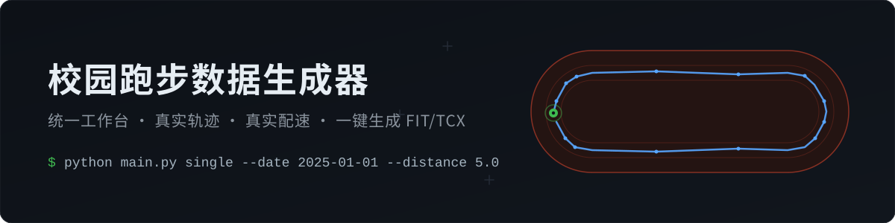
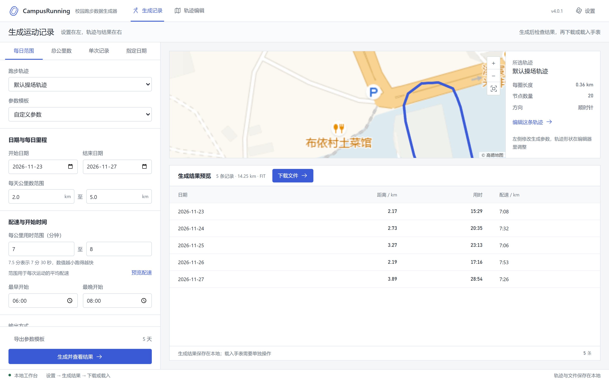
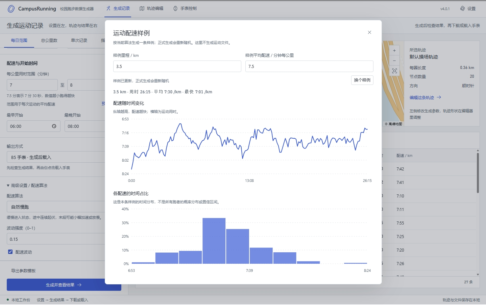
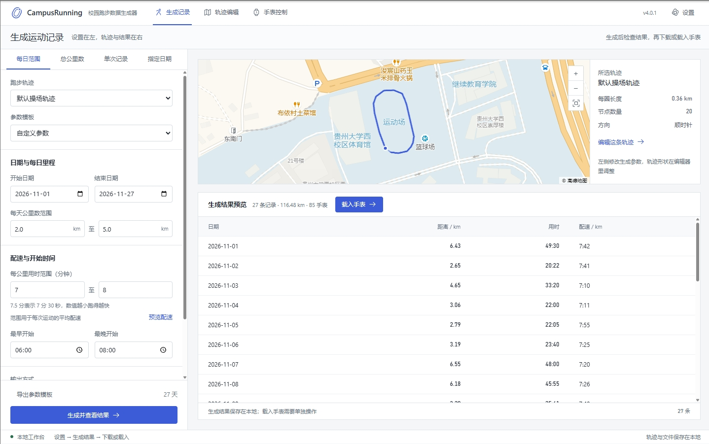
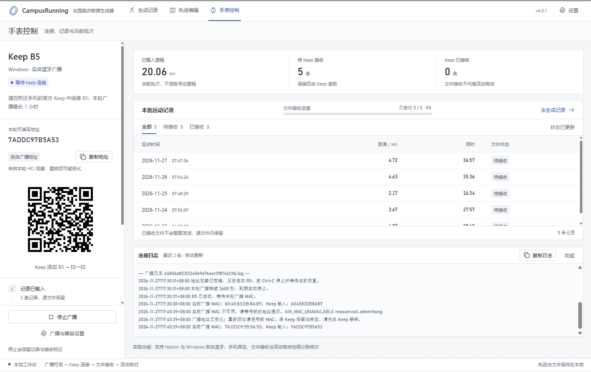
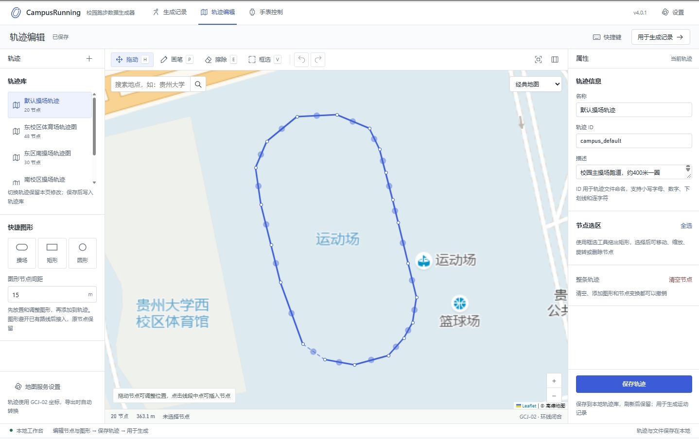

<div align="center">
  
  <p>
    <a href="LICENSE"></a>
    
    <a href="https://github.com/YuShenLiu06/CampusRunning"></a>
  </p>
</div>

> **免责声明**
>
> 本项目及其 Keep B5 手环模拟与同步组件**仅供学习使用**。请在有权操作的设备、账号和环境中使用，并遵守适用法律法规、学校规定及平台条款。
>
> 使用者自行承担因其违法、违规或未经授权使用本项目而依法应承担的责任。在适用法律允许的范围内，本项目按现状提供，担保与责任限制见 [MIT 许可证](LICENSE)。

## 天下苦校园跑久矣

早起打卡、里程配速，一样不能少——天下学子苦其久矣。

社区已有不少虚拟定位方案，各有取舍；本工具走了另一条路：**生成带真实操场轨迹、真实配速与步频步数的运动数据文件（默认 FIT，兼容 TCX），导入运动软件即可使用**。

作者坚持为爱发电，愿普度天下苦校园跑的学子。若这个项目帮到了你，点亮 Star 便是对作者最好的鼓励。

## 它能做什么

四种生成模式，覆盖从「补一次记录」到「整学期一次配齐」：

| 模式 | 命令 | 适用场景 |
|------|------|----------|
| 每日范围 | `daily` | 给定日期区间，每天在公里数范围内随机生成 |
| 总公里数 | `total` | 给定总里程，自动分配到每天（周末可为平日 1.5 倍，支持每周休息日） |
| 单文件 | `single` | 为特定日期补一条指定里程的记录 |
| 指定日期批量 | Web 专属 | 日历中勾选任意日期组合，逐日批量生成 |

每条记录由五层机制撑起「真实感」：

- **真实轨迹**——基于操场坐标生成顺时针 GPS 轨迹点，内置多条校园轨迹，也可自行添加
- **配速模型与预览**——自然慢跑、稳定跑、渐进跑三种模拟算法，可查看时间曲线和配速分布，支持[自定义算法](docs/pace-models.md)
- **真实步频步数**——按配速与里程生成符合真实分布的步频曲线，FIT 与 TCX 均写入
- **坐标转换**——按轨迹所在地域将 GCJ-02 自动转换为 WGS-84，避免导入后区域性偏移
- **可视化轨迹编辑器**——Web 内在高德地图上标点绘制轨迹，一键保存为配置

CLI 与 Web 双入口，生成结果一致。Web 端为 4.0 统一工作台：生成、轨迹编辑与手表管理同页完成，生成后可打包下载，手表环境就绪时也可直接载入。

## 快速开始

### 桌面版（推荐 · 即开即用）

**无需 Python 环境**，从 [GitHub Releases](https://github.com/YuShenLiu06/CampusRunning/releases) 下载即用：

| 平台 | 下载文件 | 说明 |
|------|----------|------|
| Windows | `CampusRunningGen-Setup-v<版本>-win64.exe` | 安装包（推荐）或便携 zip |
| macOS (Apple Silicon) | `CampusRunningGen-Setup-v<版本>-macos-arm64.pkg` | 安装包（推荐），放行一次后安装即用 |
| macOS (Apple Silicon) | `CampusRunningGen-v<版本>-macos-arm64.zip` | 便携版，解压后需执行 xattr 放行 |

功能与 Web 版完全一致。系统要求、SmartScreen / Gatekeeper 放行方法与数据位置说明见[桌面版文档](docs/desktop-packaging.md)。

> **高德地图配置**：桌面版中使用「官方」地图档或地址搜索功能时，推荐通过配置文件设置高德 Key（见[高德 Key 申请教程](docs/amap_key_guide.md)的「桌面版配置」章节），以避免 WebView2 的 localStorage 持久化问题。

### Web

需要 Python 3.13+，安装依赖后启动：

```bash
pip install flask garmin-fit-sdk
python app.py    # 浏览器访问 http://127.0.0.1:5000
```



表单化操作，所见即所得：

- **四种生成模式**——每日范围 / 总公里数 / 单文件 / 指定日期批量（日历勾选）
- **模板**——表单参数一键存成模板，下次直接套用
- **配速算法与曲线预览**——在高级设置中选择算法与波动强度，生成前直接预览曲线和分布
- **轨迹编辑器**——高德地图上标点、画笔、快捷图形与框选变换，实时查看距离，保存即入轨迹库
- **生成结果**——逐条核对日期、里程与配速，一键 ZIP 下载 FIT/TCX；手表环境就绪时也可载入手表



### CLI

```bash
# 最快验证：生成一次 5 km 记录
python main.py single --date 2025-01-01 --distance 5.0

# 整月按每日范围生成
python main.py daily --start-date 2025-01-01 --end-date 2025-01-31 --min-km 2 --max-km 5

# 组合：模板 + 指定轨迹 + 打包 ZIP
python main.py daily --template easy_run --track campus_default --zip \
  --start-date 2025-01-01 --end-date 2025-01-07 --min-km 2 --max-km 5
```

完整参数说明见 [API 参考](docs/api_reference.md)。

### 让 AI 替你跑

仓库内置 Agent Skill（`.claude/skills/campusrunning-cli/`，软链入口在 `.agents/skills/`）。用 Claude Code 等 AI 编码工具打开本项目，说一句「帮我生成 9 月整月、每天 2~5 km 的跑步数据」即可——选命令、配参数这些事交给 AI，无需费脑。

### 导入手机

生成结果如何导入 Keep，见 [Keep 导入教程（含截图）](guied.md)。默认输出 FIT 格式（Keep 导入推荐，带完整步频/步数数据）；也可切换 TCX——它是通用格式，Garmin Training Center、GoldenCheetah、Strava 等软件可直接打开。

## 实验性内容：手表导入（Keep 手环 B5）

> **实验性功能**：需要独立实验环境与真实蓝牙，验收边界见下文，不代表正式导入功能。

4.0 起内置手表管理：复用同一套生成流程，直接产出 Keep 手环 B5 的运动数据——单次最多 64 条，逐条收讫，重启不重发。工作台选择「B5 手表」输出方式生成，检查结果后载入手表：



手表控制页实时显示本轮广播地址与连接二维码——地址每轮变化，以页面当前显示为准。手机 Keep「添加 B5 → 扫一扫」可替代手动输入地址，随后等待 Keep 读取文件：



- **两种接入方式**——官方 Android 模拟器（API 35，无需实体蓝牙）与 Windows 实体蓝牙入口；面板实时显示本轮广播地址、连接状态与传输进度
- **验收边界**——Android Keep 已完成绑定、完整传输与有效活动入账；iOS 与稳定重连尚未通过验收，文件领取成功不代表活动有效
- **环境要求**——需要独立实验环境（Windows 需 BTVS/TShark 与独立 Python 3.11），桌面安装包不含完整 B5 环境

运行步骤见[连接与运行](docs/keep-b5/guides/connection-and-running.md)，适配范围与版本要求见[兼容性说明](docs/keep-b5/reference/compatibility.md)。

## 配置

### 添加轨迹

**方式一：Web（桌面端） 轨迹编辑器（推荐）**——启动 Web 后从首页进入「轨迹编辑器」，在高德地图上标点绘制轨迹、实时查看环线距离，保存后直接写入 `config/tracks/`，无需手工拾取坐标。「官方」地图档需要配置高德 JS API Key，申请步骤见[高德 Key 申请教程](docs/amap_key_guide.md)。



**方式二：手工编辑 JSON**——在 `config/tracks/` 下新建文件：

```json
{
  "id": "my_track",
  "name": "我的轨迹",
  "description": "操场跑道",
  "base_coordinates": [
    {"longitude": 106.6591, "latitude": 26.4513},
    {"longitude": 106.6590, "latitude": 26.4516}
  ]
}
```

本项目轨迹配置使用**高德坐标系（GCJ-02）**；生成 FIT/TCX 时会逐点转换为 GPS 使用的 WGS-84。不要手工预扣偏移，也无需配置中心点差值。字段说明见[轨迹配置格式](docs/track_format.md)。

### 使用模板

模板把配速、里程、休息日等常用配置存成 JSON，一键复用：

- **Web 内创建**：填好表单 → 「导出模板」→ 命名下载
- **手工创建**：放入 `config/templates/`，格式见[模板创建指南](config/templates/TEMPLATE_GUIDE.md)
- **应用**：CLI 加 `--template easy_run`，或在 Web 中下拉选择

## 项目结构

| 位置 | 职责 |
|------|------|
| `main.py` / `app.py` | CLI 与 Web 入口 |
| `src/core/` | 轨迹分析与生成、配速波动、坐标修正、数据模型 |
| `src/planners/` | 各生成模式的距离规划策略 |
| `src/exporters/` | FIT / TCX 导出（接口抽象，可扩展 GPX） |
| `src/*.py` | 配置管理、模板管理、生成引擎编排 |
| `web/` | Flask 路由、页面与静态资源 |
| `config/` | 轨迹定义、预设模板、默认设置 |
| `experiments/keep_device/` | 独立 Keep B3/B5 适配实验；可选手表面板复用旧页面，原生生成 B5 并显示里程、连接和 MAC |

架构与数据流详见[架构说明](docs/architecture.md)。

## 文档

- [架构说明](docs/architecture.md)
- [轨迹配置格式](docs/track_format.md)
- [API 参考](docs/api_reference.md)
- [模板创建指南](config/templates/TEMPLATE_GUIDE.md)
- [高德 Key 申请教程](docs/amap_key_guide.md)
- [Keep 导入教程](guied.md)
- Keep 手环 B5 同步实验：[分类文档](docs/keep-b5/README.md) · [适配范围与环境要求](docs/keep-b5/reference/compatibility.md) · [连接与运行](docs/keep-b5/guides/connection-and-running.md)。手表页提供官方 Android 模拟器与 Windows 实体蓝牙两条路线；iOS 和稳定重连尚未通过。
- [更新日志](CHANGELOG.md)
- 维护者手册：[构建与打包](docs/maintainer/build.md) · [发版流程](docs/maintainer/release.md) · [工具速查](docs/maintainer/tools.md)

## 许可

[MIT](LICENSE) © YuShen

为爱发电，普度众生。若这个项目替你跑过一公里，欢迎点亮 Star；Issue 与 PR 一律欢迎。
