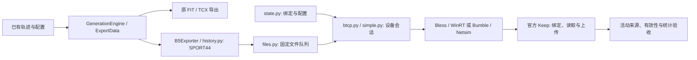

# 架构说明

## 系统概览

校园跑步数据生成器是一个用于生成模拟跑步 FIT/TCX 文件的 Python 工具，支持 CLI 和 Web 两种使用方式。

## 核心架构

```
用户输入 (CLI / Web)
    │
    ▼
ConfigManager ──加载──▶ config/*.json
    │                    ├─ tracks/      (轨迹定义)
    │                    ├─ templates/   (预设模板)
    │                    └─ default_settings.json
    │
    ▼
TemplateManager ──合并──▶ GenerationConfig
    │
    ▼
GenerationEngine ◄──┬── Planner (daily/total/single)
    │                │
    │                └── TrackGenerator ◄── TrackAnalyzer
    │                                    ├── CoordinateCorrector
    │                                    └── PaceFluctuator
    │
    ▼
Exporter (FIT / TCX)
    │
    ▼
输出文件 (.fit / .tcx)
```

## 核心模块

### src/core/

| 模块 | 职责 |
|------|------|
| `__init__.py` | 核心模块导出 |
| `models.py` | 数据模型定义（GeoPoint, TrackDefinition, GenerationConfig等） |
| `track_analyzer.py` | 轨迹分析（Haversine距离、Shoelace方向判定） |
| `track_generator.py` | 轨迹生成（插值、随机偏移、平滑处理） |
| `coordinate_corrector.py` | GCJ-02 到 WGS-84 坐标转换 |
| `pace_fluctuator.py` | 配速波动模拟（热身→稳定→疲劳→冲刺） |
| `cadence_generator.py` | 步频/步数生成（速度→步频映射、Lap 级步数积分） |
| `helpers.py` | 通用工具函数 |

### src/planners/

| 模块 | 职责 |
|------|------|
| `__init__.py` | 规划器模块导出 |
| `daily_planner.py` | 每日范围规划（随机距离分配） |
| `total_km_planner.py` | 总公里数规划（工作日/周末分离） |
| `single_planner.py` | 单文件规划 |

### src/exporters/

| 模块 | 职责 |
|------|------|
| `__init__.py` | 导出器模块导出 |
| `base.py` | 抽象导出器接口 |
| `tcx_exporter.py` | TCX格式导出实现 |
| `fit_exporter.py` | FIT格式导出实现（默认格式；Keep 的 TCX 导入通道不解析步频，见 issue #8） |

### src/

| 模块 | 职责 |
|------|------|
| `config_manager.py` | 配置加载管理 |
| `template_manager.py` | 模板应用系统 |
| `generation_engine.py` | 生成引擎编排层 |

## 数据流

1. **配置加载**：ConfigManager 读取 JSON 配置文件
2. **模板应用**：TemplateManager 合并模板与覆盖参数
3. **规划生成**：Planner 根据策略生成 DailyPlan 列表
4. **轨迹生成**：TrackGenerator 生成 GPS 坐标序列
5. **配速模拟**：PaceFluctuator 生成配速曲线
6. **数据导出**：Exporter 生成 FIT 或 TCX 文件

## Keep 设备适配实验

`experiments/keep_device/` 是独立的设备侧适配模块，复用主项目 `ExportData`。默认主应用不加载实验依赖；可选 `dashboard.py` 复用原 Web 四模式，通过构造注入 `B5Exporter` 原生输出，并增加手表管理页。源坐标在生成阶段已经从 GCJ-02 转为 WGS-84，设备编码器不再转换。



`windows.py` 和 `emulator.py` 是两个传输入口。依赖安装在仓库外独立环境；设备状态和运动文件也保存在私人目录。`files.py` 收到领取确认后原子写接收标记并隐藏队列，保留源文件；这一步先于云端有效性验收。

当前 Android B5 单条活动已完成真实验收，Windows 自动重连与 iOS Keep 未通过。模块接口和线协议详见[契约](keep-b5/reference/protocol-contract.md)，连接、退出、故障恢复和未测项见[运行说明](keep-b5/guides/connection-and-running.md)，证据见[调研报告](keep-b5/research/third-party-source-63.md)。

## 关键设计决策

### 1. 依赖注入

TrackGenerator 通过构造函数接受 TrackAnalysis、TrackAnalyzer、CoordinateCorrector，而不是自行创建。这提高了可测试性和灵活性。

### 2. Frozen Dataclass

所有数据模型（除 GenerationConfig 外）都使用 `@dataclass(frozen=True)` 确保不可变性。

### 3. 分离导出层

Exporter 抽象接口支持现有 FIT/TCX 实现；`GenerationEngine` 可通过 `exporters` 构造参数注入额外格式，通过 `strict=True` 令生成错误直接抛出。B5 只在可选面板显式注入，不注册为主应用默认导出器。共享轨迹生成按实际几何长度补足距离、保留整公里采样，摘要时间/配速与实际轨迹一致。

### 4. 配置即代码

模板系统允许将常用配置保存为 JSON 文件，通过 `--template` 参数加载。
