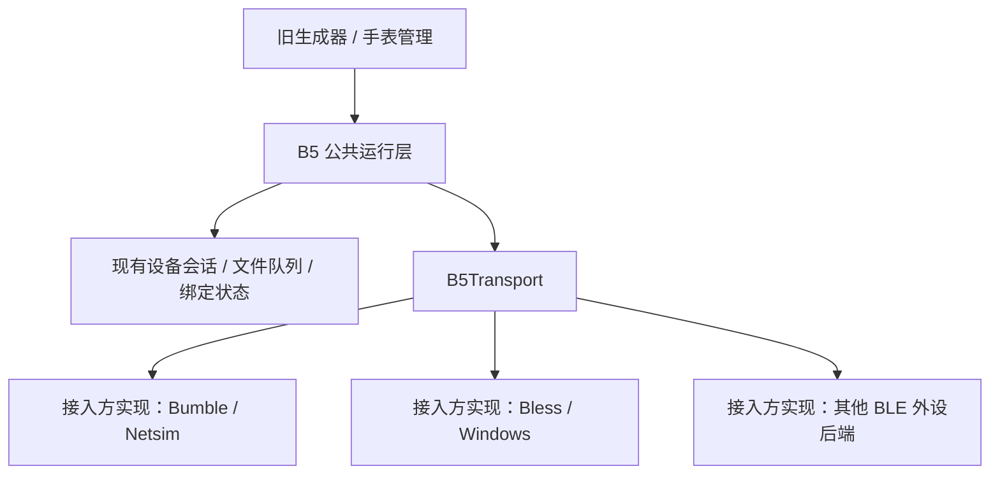

# 可替换蓝牙传输接口

这是后续统一传输实现的接口契约，类型定义见 [transport.py](../../../experiments/keep_device/transport.py)。现有 Netsim 和 Windows 入口尚未改为实现此接口；手表面板直接复用两个入口管理自有进程，Windows 启动器通过结构化事件报告状态。面板本机检查已通过，手机联调与多模拟器隔离尚未完成。

现有入口的模拟器版本、实体蓝牙要求和验收范围见[适配范围与环境要求](../reference/compatibility.md)。

## 边界



| 公共运行层负责 | 接入方的传输实现负责 |
|---|---|
| 原生生成、校验和固定文件队列 | 选择物理适配器、模拟器实例或虚拟无线环境 |
| B5 帧/CRC/分片、业务应答、独立连接会话 | 使用已有库建立 GATT、广播、收写入、发送通知 |
| 绑定与文件收讫的持久化 | 底层线程切回公共 asyncio 事件循环 |
| 已载入里程、待同步/已领取数量 | 真实连接、订阅、通知容量和广播地址观察 |
| 启停生命周期和面板状态 | 本实例资源清理、临时名称等设置恢复 |

传输实现不读取轨迹目录、不生成运动、不写收讫标记，也不把 Keep 的上传接口当成蓝牙替代。`history.py`、`files.py`、`state.py` 和 `DeviceInfoSession` 继续复用，不再另写蓝牙栈或第二套 B5 协议。

## 三个操作

```python
class B5Transport(Protocol):
    async def start(self, *, name: str, events: TransportEvents) -> None: ...
    async def notify(self, connection_id: str, packet: bytes) -> None: ...
    async def stop(self) -> None: ...
```

接入方先构造实现，目标与配置通过自己的构造参数提供。公共层依赖 `B5Transport`，不识别 Netsim 端口、ADB 序列号、操作系统设备路径或模拟器品牌。不设置统一的 `discover()`、全局插件注册器或任意配置字典；现阶段通过构造注入即可。

固定 GATT 取值沿用 `btcp.py`：服务 `0000190a-0000-1000-8000-00805f9b34fb`，写特征 `00000001-0000-1000-8000-00805f9b34fb`（Write / Write Without Response），通知特征 `00000002-0000-1000-8000-00805f9b34fb`（Notify）。名称使用已验证的 `KeepB5` 前缀。适配器复用各平台现成广播编码及 GATT API，不要求接入方手写蓝牙协议。

`start()` 返回表示底层已确认开启广播；启动子进程成功不够。地址查询可以仍未完成，此时必须报告地址未知。活动状态下再次 start 报错；失败后清理自有资源，stop 可重复调用，stop 后允许重新 start。

`notify()` 接收公共层已经编码和分片的一包原始字节，不重新分片或改写内容。发送必须指定活跃通知订阅者；旧连接、未订阅、容量超限、超时或底层报告部分发送时抛 `TransportError`。底层确认只说明提交/发送成功，BLE Notification 本身没有应用级收讫保证。文件已领取只依据既有文件 RPC，活动有效性仍由 Keep 验收。

## 四类事件

| 回调 | 内容与规则 |
|---|---|
| `on_address(BindingAddress)` | 本轮可填写地址及 `virtual/physical` 范围；未知、轮换失效或停止时 value 为 None |
| `on_link(LinkState \| None)` | 活跃连接的匿名标识、通知订阅状态及最大通知值字节数；断开为 None |
| `on_write(connection_id \| None, packet)` | 原样交付写特征收到的字节；不能识别写入者时显式传 None |
| `on_error(TransportError)` | 运行期间致命错误，公共层进入失败并停止本生命周期；错误消息不含原始流量或凭据 |

`connection_id` 是连接生命周期的临时标识，不是 MAC 或账号。重连必须换新值；同一连接更新订阅或通知容量时保持不变。通知容量是特征值可用长度，例如 ATT MTU 23 对应 20 字节；公共 B5 层继续取 `min(notification_limit, 244)` 编码。

公共层每次 start 创建新一组回调和运行代次，忽略旧代次的迟到事件；连接变化后丢弃旧连接的排队请求和会话。事件需有序交付并等待完成，不能为每个写请求无限创建后台任务。跨线程适配器负责有界调度，公共层延续现有最多 8 个待处理请求及通知超时控制。

一个实例只服务一个活跃客户端。第二个客户端无法拒绝或写入来源无法安全归属时，应拒绝处理业务并明确报告歧义，不把第一台的回复发给第二台。Windows Bless 当前无法识别每个写入者，须报告 `connection_id=None`；只有一个活跃订阅者时公共层可以沿用现有实验策略处理，但这不构成写入身份认证。不得给这类事件伪造“已验证写入者”。

`on_write` 抛 `ValueError` 时拒绝非法/不支持请求，抛 `OSError` 时表示持久化失败。能返回 ATT 错误的后端按现有行为映射；Write Without Response 或已经被库确认的底层写入，不得伪称撤销了 ATT 确认，只是不发送成功的 B5 业务应答。

## 身份地址与广播地址分开

| 字段 | 含义 |
|---|---|
| 公共层已有 `BindingState.mac` / DeviceInfo MAC | 设备业务身份；保持原有绑定和状态一致性 |
| `BindingAddress.value` | 本轮可用于 Keep 添加的地址；统一大写冒号分隔六字节，未知为 None |
| `BindingAddress.medium` | `virtual` 表示虚拟无线环境，`physical` 表示实体无线广播 |

例如 `E2:37:46:91:48:63` 目前属于虚拟广播，不能据此声称附近手机可见。实体实现必须观察到本轮控制器广播配置成功后才报告地址，不能使用电脑永久蓝牙地址替代；现有 Windows 路线继续复用 BTVS/TShark。停止或地址观察失效后清空“Keep 输入地址”，可另保留明确标注的设备身份信息。

接口不承诺可以设置实体空中 MAC，也不提供 `set_mac()`。选择模拟器与隔离多个模拟器环境由接入方完成；选择了一个窗口或使用不同 MAC，不代表无线环境已隔离。

## 接入验收

实现者至少验证以下行为，才能把后端接进面板：

1. start 确认真实广播；启动失败清理资源；stop 重复执行安全，旧事件不污染新运行。
2. 正确区分未知地址、虚拟地址、实体本轮地址；轮换与停止时使旧值失效。
3. 未订阅和断开的连接不发送通知；容量变化正确生效；发送失败不报成功。
4. 原始写入进入同一套 `DeviceInfoSession`，按序回复，队列满或来源歧义时明确拒绝。
5. 用同一文件队列完成读取/收讫，重启保留标记；连接成功与活动有效分别报告。

后续迁移先让公共运行层接收 `B5Transport`，再将现有两个传输实现包装为适配器。当前 Windows 面板消费启动器的 `WATCH_EVENT` 事件，Netsim 面板仍解析既有日志；这不是任意后端注册能力。文件生成和协议编码保持复用。
