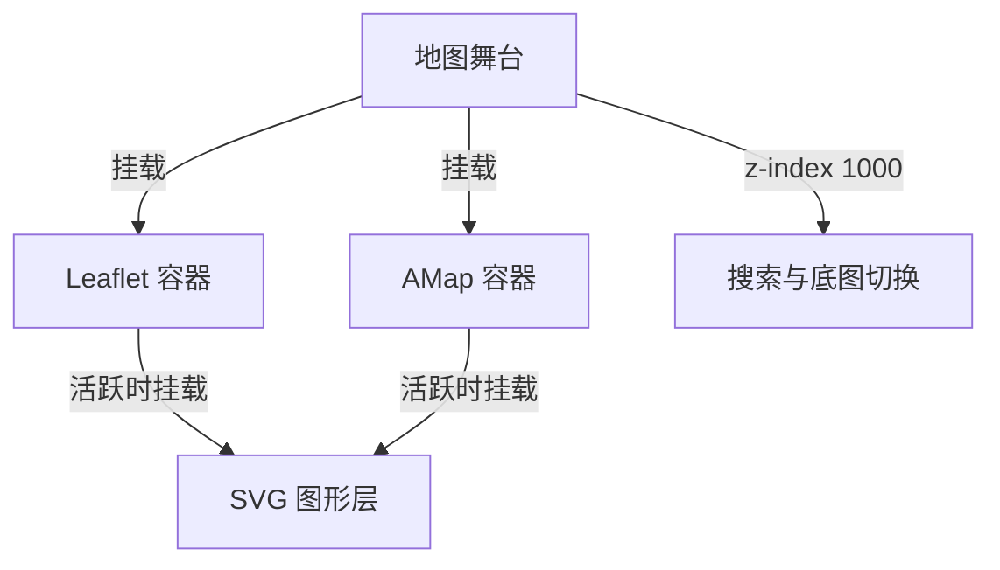

# 轨迹编辑器图形模板设计

本页说明 `/track-editor` 图形模板的设计约束与维护边界，替代已完成的施工计划。
原始实现基准：PR #51，`495233f`；本页同时记录针对该版本评审问题的修复约束。
本页不代表修复已经通过验收；回归要求与验证边界见§九。

## 一、模块职责

图形只在编辑期存在；生成后写入与手画轨迹相同的点列，不扩展轨迹 JSON、后端或导出协议。

| 职责 | 权威实现 | 分层理由 |
|---|---|---|
| 几何、采样、手柄变换 | [shape_geometry.js](../../../web/static/js/shape_geometry.js) | 无 DOM 或地图依赖，供浏览器与 Node 共用 |
| SVG、指针与视野同步 | [shape_layer.js](../../../web/static/js/shape_layer.js) | 两个地图引擎共用一套图形交互 |
| 生成、撤销与保存目标 | [track_editor.js](../../../web/static/js/track_editor.js) | 沿用现有轨迹编辑与保存流程 |
| 地图换算与事件转发 | [map_engine.js](../../../web/static/js/map_engine.js) | 通过 [Leaflet](../../../web/static/js/map_adapter_leaflet.js) / [AMap](../../../web/static/js/map_adapter_amap.js) 适配器隔离 SDK 差异 |

不增加运行时依赖、构建步骤或持久化图形模型；不提供吸附、对齐、椭圆和数值旋转输入。
脚本依赖顺序由 [页面模板](../../../web/templates/track_editor.html) 维护，样式由 [track_editor.css](../../../web/static/css/track_editor.css) 维护，不在文档复制实现。

## 二、几何模型

### 2.1 米制尺寸与地理锚点

每个图形持有唯一 `id`、类型、地理中心、米制宽高及旋转角。中心是位置的唯一真源，像素坐标随视野换算。

| 类型 | 尺寸约束 | 形状含义 |
|---|---|---|
| 矩形 | 宽高独立 | 轮廓与局部包围盒一致 |
| 圆形 | 宽 = 高 = 直径 | 保持正圆，不随单轴拖动变成椭圆 |
| 操场 | 宽 = 直道长 + 高；高 = 2 × 半径 | 两条直道连接两个半圆；直道长允许为0 |

### 2.2 默认尺寸

默认尺寸贴近操场量级，便于直接调整。下表区分解析周长与采样后的折线距离，二者不要求相等。

| 图形 | 默认尺寸 | 解析周长 | 默认点数 / 闭环距离 |
|---|---|---:|---:|
| 矩形 | 100 × 60 m | 320.0 m | 32 / 320.0 m |
| 圆形 | 半径60 m | 377.0 m | 38 / 376.6 m |
| 操场 | 直道84.39 m、半径36.5 m | 398.1 m | 38 / 397.3 m |

### 2.3 单位与精度边界

位置使用项目既有 GCJ-02 坐标。米与经纬度采用中心点附近的切平面近似，面向校园场地尺度。
地球半径取6371000 m，与既有 Haversine 环线统计一致；经度换算随中心纬度调整，并对近极点余弦设下限。
这不等同于全纬度、大尺度图形的精度保证。公式与常量以几何模块为准。

宽高下限为5 m。目标间距默认10 m，输入范围3–100 m；间距与点数策略见§三。

### 2.4 局部坐标约定

局部原点为图形中心，`+x`向东、`+y`向北。`rotation`以弧度表示，逆时针为正；零角度时局部`+x`朝正东。
SVG的y轴向下，因此投影到屏幕时翻转y方向。指针换算先撤销屏幕缩放与y翻转，再做逆旋转。
这些约定同时约束轮廓、采样与手柄，避免两地图引擎各自实现图形数学。

## 三、轮廓采样

### 3.1 以基元保留角点

按逆时针顺序分解轮廓，保证矩形角点和操场切点进入采样点列。

| 图形 | 起点 | 基元顺序 |
|---|---|---|
| 矩形 | 西南角 | 底、右、顶、左四条直线 |
| 圆形 | 正东方向 | 一个完整圆弧 |
| 操场 | 下方直道左端 | 下直道、右半圆、上直道、左半圆 |

### 3.2 间距表示目标密度

每个非零长基元按长度与目标间距分配采样数，再按闭环有效性和§3.3的总预算约束调整。
采样包含基元起点、不包含终点，让下一基元提供连接处的点。矩形角点和操场切点因此不会被整圈等距重采样切掉。

点数随尺寸呈阶梯变化，不是严格线性增长；实际间距也不固定等于输入值。
弧的相邻采样点以弦连接，故统计距离略小于解析弧长。即使图形很小或间距很大，也必须保留至少3个不同位置，形成有效闭环。
操场直道为0时按退化圆处理；不对零长直道额外采点，不在首尾或基元连接处重复采点。

### 3.3 单图形点数预算

单图形最多生成500点；预算必须约束各基元采样数之和，不能仅抬高有效间距后任由逐段取整超限。
分配预算时仍需保留矩形角点、非退化操场切点及至少3个不同位置。
多图形拼接后没有整条轨迹的总点数上限。

### 3.4 多图形连接

按放置顺序拼接各图形点列，最后闭合整条轨迹。分开放置的图形之间会出现直线连接段。
预览显示完整拼接结果，包括连接段；生成使用同一采样规则，避免生成后才暴露跨图形连线。

## 四、地图与覆盖层

### 4.1 活跃地图内的覆盖层与事件隔离

图形宿主挂在当前活跃地图容器内，切换引擎时迁移同一个宿主；图中两条挂载边是互斥状态。
图形层使用z-index 650，高于Leaflet顶点层，低于舞台上的搜索与底图切换控件。
默认让指针穿透，轮廓和手柄负责命中。左键模板编辑阻止向地图传播，避免画笔误加点或触发地图点击；滚轮与中键沿原生事件路径交给地图引擎，不复制一套地图手势逻辑。

生成后隐藏模板覆盖层并取消选中，释放对轨迹顶点和中点的遮挡。模型与侧栏条目保留，点击条目或添加模板可恢复图形编辑。

### 4.2 适配器负责投影与事件

`MapEngine`向活跃适配器转发地理坐标与容器像素的双向换算，并保留视野钩子。
切换引擎后重新绑定钩子、立即同步一次；绑定前解除旧回调，避免重复监听。
Leaflet监听移动与缩放；AMap监听`mapmove`、`zoomchange`和`viewchange`，官方引擎的实际效果需有效测试Key验证。

### 4.3 视野变化与缓存

图形层用屏幕中心到其上方50 px的地理距离估算像素/米比例，避免低zoom时固定经纬度偏移不足1 px。
尺寸、角度或采样变化时重建SVG；视野变化且比例相对变化小于1%时，当前实现只平移已有图层。
舞台宽高也参与缓存有效性判断；视口尺寸变化时同步SVG边界并重新定位，不能只平移旧尺寸的SVG。

### 4.4 Leaflet缩放动画

缩放动画中，Leaflet投影可能仍使用旧zoom。图形层在动画开始时设透明，结束时恢复并重定位，避免展示错位的中间帧。
不要把该策略解释为AMap动画已验收；两引擎需分别验证。

## 五、模板交互

### 5.1 八向缩放与对侧锚点

每个图形使用包围盒的四角、四边中点及一个旋转手柄。缩放时固定对侧手柄的地理位置；越过锚点时允许翻转。
先施加圆形等宽高、操场宽不小于高等约束，再用约束后的尺寸反算中心，避免对侧锚点漂移。
圆形角手柄同时驱动两轴，边中点按被拖动轴调整直径，不能让未变化的另一轴阻止缩小。

手柄随图形旋转；旋转手柄沿局部上方外移28 px，保持屏幕上可抓取的距离。

### 5.2 拖动、选择与删除

图形本体拖动修改中心；手柄分别修改尺寸或角度。每次拖动以按下时的快照计算，避免逐帧累积误差。
旋转记录抓取方位偏移，避免按下时跳角度；指针捕获落在常驻宿主上，避免SVG重建时丢失捕获。

点击图形或侧栏条目可选中；点击地图空白或按Esc取消选中。Delete/Backspace删除选中图形，但输入框聚焦时不执行删除。
只用左键编辑图形；中键拖动与滚轮缩放在模板内外都应保持地图操作语义。

### 5.3 视觉来源

轮廓、采样点、选中框与手柄样式以样式表为准。首个预览点与普通点区分，帮助识别点列起点。
不在设计文档复制颜色、半径或CSS声明，避免样式改动需要平行维护。

### 5.4 撤销只记录轨迹点

图形拖动、缩放、旋转和删除不进入轨迹撤销栈。生成前保存一次旧点列，因此Ctrl+Z可整体撤销生成，重做可恢复生成结果。
轨迹撤销不修改图形模型，也不自动恢复生成后隐藏的模板覆盖层。

## 六、生成与保存目标

有旧轨迹点时，生成先要求确认替换；取消不改点列或模板编辑状态。确认后按§5.4记录历史，再替换整条点列并退出模板编辑；模型保留，覆盖层隐藏。
生成保留当前保存目标与坐标修正属性；编辑已加载轨迹时，随后保存会沿用该轨迹ID。不要用内置轨迹做覆盖测试。
无图形时禁用生成和清空图形按钮；引擎未就绪时禁用放置按钮。

## 七、生命周期

| 操作 | 图形状态 | 轨迹状态 |
|---|---|---|
| 放置模板 / 点击侧栏条目 | 新增或选中，并恢复覆盖层显示 | 不变 |
| 生成轨迹点 | 保留模型，隐藏覆盖层并取消选中 | 按§六替换 |
| 清空图形 | 清空 | 不变 |
| 清空轨迹 | 保留 | 清空，可撤销 |
| 新建空白 / 成功加载轨迹 | 清空 | 新建或加载，并清空历史 |
| 切换底图 | 保留模型和编辑显隐状态，迁移宿主并重新定位 | 保留并重绘 |
| 页面刷新 | 丢弃未持久化的图形 | 按编辑器既有加载规则处理 |

## 八、测试入口

在独立工作树安装项目依赖；几何测试还需Node。运行 `python -m pytest`，并检查是否有skip；缺Node时[pytest桥](../../../tests/test_shape_geometry.py)会跳过几何测试，不能据此宣称前端已覆盖。
几何用例的权威来源是 [test_shape_geometry.js](../../../tests/js/test_shape_geometry.js)，也可直接运行 `node tests/js/test_shape_geometry.js`。
单元测试不验证地图事件、DOM命中或真实保存，浏览器验收见§十。

## 九、修复回归与验证边界

以下记录原始基准中发现的问题及修复必须满足的结果，不表示测试已经通过：

| 场景 | 原始问题 | 回归要求 |
|---|---|---|
| 小圆 / 大间距 | 生成1–2点，无法保存 | 至少3个不同位置，形成可保存闭环 |
| 操场直道为0 | 宽高73 m、间距100 m时4点仅有2个不同位置 | 退化圆无重复采点，闭环有效 |
| 非对称大矩形 | 1003 × 177 m、间距3 m生成502点 | 各基元合计严格不超过500点 |
| 窗口扩大 | 旧SVG边界裁切模板 | SVG尺寸随舞台更新，图形和手柄继续可见 |
| 生成后的模板 | 覆盖轨迹顶点和中点 | 释放遮挡，可拖点、插点和擦点 |
| 模板内地图输入 | 滚轮和中键被图层拦截 | 模板内外均可缩放和平移，且不误加轨迹点 |

官方AMap需要有效测试配置和网络；在线瓦片不可达时，灰底上的交互通过不代表地图图像或双引擎通过。
如需回退功能，撤销本PR对应改动；不要照施工草稿手动删除文件，以免漏掉共享函数和脚本依赖。

## 十、浏览器验收

在隔离工作树运行 `python app.py`，按服务打印的地址打开 `/track-editor`。官方引擎凭据只放隔离配置，不写进截图或提交。
下表列验收目标，不表示当前实现全部通过；§九的每项修复都需重测对应路径。

| 场景 | 验收要点 |
|---|---|
| 三模板与手柄 | 放置、移动、八向缩放、旋转；圆等比、对侧锚点稳定；默认值见§2.2 |
| 输入边界 | 尺寸下限、圆/操场退化、间距3–100 m、非对称大图形；点列应形成有效闭环 |
| 地图视野 | Leaflet低/高zoom、缩放动画、平移、窗口缩放、离屏拖动；有测试Key时做AMap往返切换 |
| 工具隔离 | 画笔不误加点；模板内外的滚轮/中键；生成后顶点拖动、插点和擦点 |
| 生命周期 | 替换确认/取消、撤销/重做、清空图形/轨迹、新建、成功及失败加载 |
| 保存与下游 | 新测试ID保存再加载；多模板高点数轨迹进入生成器，导出FIT/TCX并检查结果 |

下游冒烟顺序：放置模板、调整间距 → **生成轨迹点** → 用未使用的测试ID保存 → 在生成器选择该轨迹并导出。
若使用CLI，命令必须同时包含日期与距离，例如 `python main.py single --track <测试ID> --date 2026-10-13 --distance 3 --output-dir <隔离输出目录>`。
通过时应正常结束且指定目录出现FIT文件；结束后只清理本次创建的测试轨迹与输出，并检查 `git status --short`。
